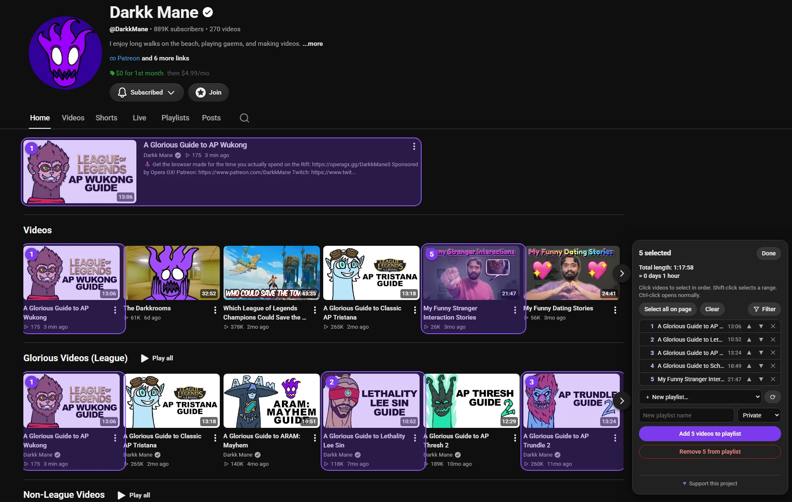

# Lasso: Video Multi-Select for YouTube

Lasso is a Chrome extension for building and cleaning up YouTube playlists in bulk. Select as many videos as you like, in the order you want them, then add them all to a playlist (or remove them all from one) in a single step.

## What it does

- **Select in order.** Click videos on any YouTube page; each gets a numbered badge showing its position.
- **Add to a playlist.** Send the whole selection to an existing playlist, a new one, or one you paste a link to. Videos are added in the order you selected them.
- **Remove from a playlist.** Remove every selected video from the chosen playlist, for mass clean-up or emptying a playlist.
- **Select by title.** Type part of a title and select every video on the page that contains it.
- **Total length.** The panel shows the combined length of the selection, in hours and in days and hours.
- **Playlist duration.** On any playlist page, a panel shows the playlist's total length, how many videos were counted, and how many were not. A **Load all videos** button loads playlists longer than 100 videos.
- **Keeps your selection.** The selection survives searches and page changes, so you can collect hundreds of videos from many pages before adding them.

## Install

1. On this repository's page, click **Code → Download ZIP** and unzip it.
2. In Chrome, open `chrome://extensions`.
3. Turn on **Developer mode** (top right).
4. Click **Load unpacked** and choose the unzipped folder (the one containing `manifest.json`).
5. Reload any YouTube tabs that were already open.

To update later, download the ZIP again, replace the files, click the reload icon on the extension's card in `chrome://extensions`, and reload YouTube.

## How to use

1. Sign in to YouTube.
2. Click the **Lasso** icon (four frame corners around a play symbol) in YouTube's top bar (next to Create). The panel opens at the bottom right; click the icon again to close it.
3. Select videos:
   - **Click** a video to select or deselect it.
   - **Shift-click** to select everything between the last video you clicked and this one.
   - **Ctrl-click** (Cmd-click on Mac) to open a video normally.
   - **Select all on page** selects every video currently loaded on the page.
   - **Filter** opens a **Title contains…** box that selects every loaded video whose title includes the text you type (not case-sensitive).
4. In the panel you can reorder videos with ▲ / ▼, remove one with ✕, or **Clear** everything.
5. Choose a playlist in the dropdown, or pick **＋ New playlist…** or **Paste playlist link…**. Use ⟳ to reload your playlist list.
6. Click **Add N videos to playlist** or **Remove N from playlist**.
7. Click **Done** (or press Esc) to leave select mode.

### Seeing a playlist's total duration

1. Open a playlist page (`youtube.com/playlist?list=…`), or a video with a playlist open beside it.
2. The **Playlist duration** panel appears by the playlist's header. It shows the total as h:mm:ss, as hours, and as days, hours and minutes.
3. If the playlist has more than 100 videos, click **Load all videos** so every video is counted.
4. "Videos not counted" covers videos not loaded yet and videos with no length (private, deleted, live or upcoming).

This works on its own; you don't need to turn Lasso's select mode on.

### Emptying a playlist

1. Open the playlist and click **Load all videos** in the Playlist duration panel (or scroll to the bottom) so every video has loaded.
2. Click **Select all on page**.
3. Choose that same playlist in the dropdown.
4. Click **Remove N from playlist** and confirm.
5. Reload the page to see the result.

## Good to know

- Removal cannot be undone, and it removes every copy of a video if the playlist contains it more than once.
- Videos are sent 20 at a time. If any fail (for example a private or deleted video), they stay selected so you can retry.
- Lengths are read from the time badge on each thumbnail. Shorts and live streams have none and are counted as "unknown length".
- The extension works only on `www.youtube.com`, acts as the account you are signed in to, and sends nothing anywhere except YouTube.
- It relies on the same internal requests the YouTube site uses, not the official API, so there is no daily limit. A YouTube redesign could break it until the extension is updated.

## Support

If this saves you time, you can support the project on Ko-fi: https://ko-fi.com/K7O62AUP2Z
